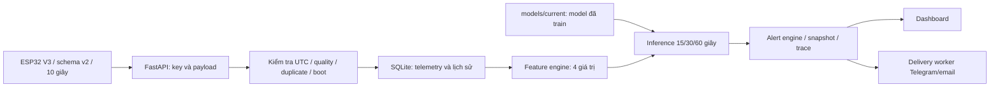

# Kiến trúc IoT và AI runtime

Không có training, generator hay evaluation trong runtime. Model nhận rain_rate_mmh,
rain_sum_window_mm, water_level_cm và water_delta_window_cm đúng thứ tự.

Profile model hiện tại: config/ai.demo.json, cadence 5 giây, mưa tích lũy 15 giây,
độ dâng 10 giây. Tất cả thời gian/horizon đọc từ cấu hình có validation.
Model và profile khác contract bị từ chối, không tự đổi nhãn.

Ingest commit telemetry/forecast/trace/alert state/snapshot trong transaction, publish sau commit.
Gói clock lỗi/cũ/out-of-order không thay live; thiếu/lỗi input/model trả null.
Nước mới hợp lệ chạm tràn có sensor_rule; cảnh báo sớm dùng model và ngưỡng trạm.
Recovery cần hysteresis/hold; mất forecast không tự hạ mức.

Worker claim trong transaction, retry theo giây, TTL/supersession và kênh cấu hình.
Dashboard đọc snapshot nhất quán. Demo chạy một process BE; SSE/WS phát qua đúng event loop.

Giữ migration và adapter lịch sử phút/v1/v2 để bảo toàn DB/IoT. Mode demo được ghi rõ vì
bundle đóng gói train từ synthetic; mode real không coi bundle đó là đã nghiệm thu.

Firmware gửi `sample_interval_ms` và `sample_age_ms` để backend phân biệt mẫu live
với mẫu được gửi lại từ buffer. Backend vẫn nhận schema v1 cho client cũ. Cadence
10 giây của firmware hiện chưa khớp profile demo 5 giây; xem
[phân tích cập nhật IoT V3](PHAN_TICH_CAP_NHAT_IOT_V3.md) trước khi nghiệm thu AI.
