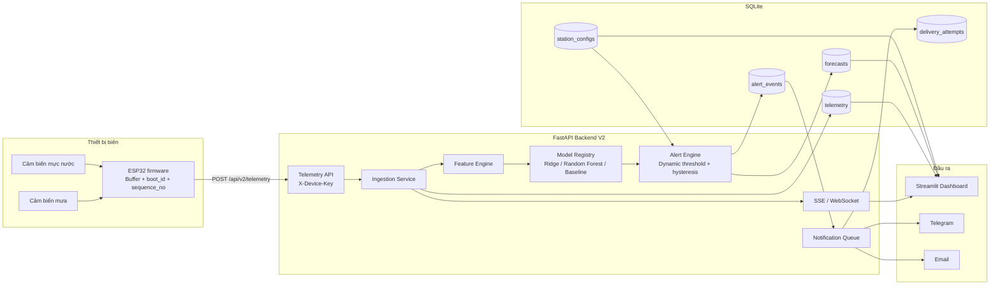
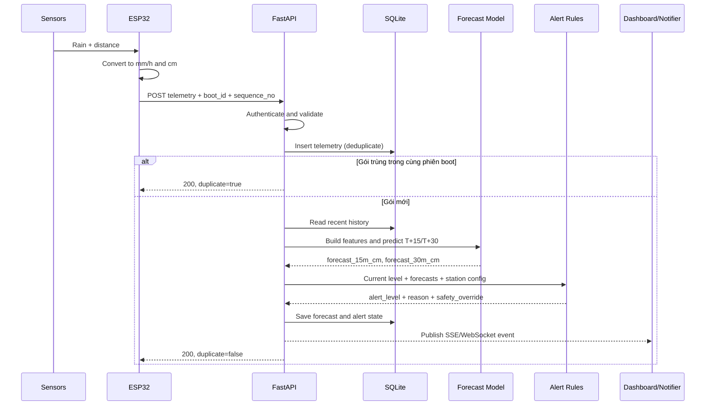
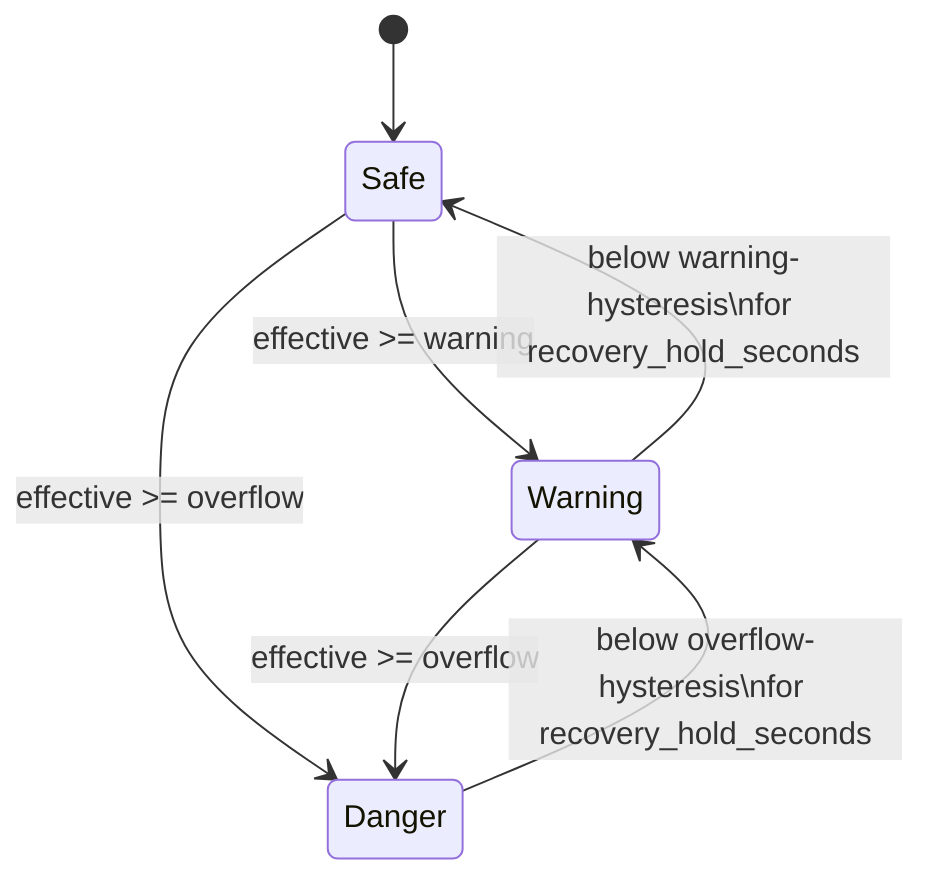

# Kiến trúc hệ thống Mini Flood AI V2

## 1. Mục tiêu kiến trúc

Mini Flood V2 là hệ thống AI–IoT thử nghiệm, nhận dữ liệu mưa và mực nước từ ESP32, dự báo mực nước sau 15/30 phút, sau đó áp dụng ngưỡng vận hành của từng trạm để sinh trạng thái **An toàn**, **Cảnh báo** hoặc **Nguy hiểm**.

Hai trách nhiệm được tách rõ:

- AI chỉ dự báo mực nước theo đơn vị centimet.
- Backend quyết định trạng thái cảnh báo bằng ngưỡng động, safety override và hysteresis.

## 2. Sơ đồ tổng thể



## 3. Thành phần

| Thành phần | Trách nhiệm |
|---|---|
| Cảm biến mực nước | Đo khoảng cách từ đầu dò xuống mặt nước; firmware đổi thành `water_level_cm = SENSOR_MOUNT_HEIGHT_CM - distance_cm`. |
| Cảm biến mưa | Cảm biến mưa RS485 Modbus cung cấp tổng lượng mưa; firmware tính `rain_rate_mmh` từ chênh lệch giữa hai lần đọc. |
| ESP32 firmware | Lấy mẫu, tạo `boot_id` cho mỗi lần khởi động, tăng `sequence_no`, đệm tối đa 100 gói khi mất mạng và gửi HTTP. |
| FastAPI | Xác thực thiết bị, kiểm tra schema, tiếp nhận telemetry và cung cấp API V2/SSE/WebSocket. |
| Feature engine | Tạo bốn đặc trưng: mưa hiện tại, mưa tích lũy 5 phút, mực nước hiện tại và độ dâng nước 2 phút. |
| Model registry | Tải artifact của từng horizon; dùng Ridge/RF nếu tốt hơn baseline, nếu không dùng baseline tuyến tính. |
| Alert engine | So sánh mực nước hiện tại và forecast với cấu hình trạm; quản lý tăng mức tức thời và hạ mức có hysteresis. |
| SQLite | Lưu telemetry, forecast, cấu hình trạm, trạng thái hệ thống và hàng đợi thông báo. |
| Streamlit | Hiển thị dữ liệu live, biểu đồ, forecast và cho phép chỉnh cấu hình ngưỡng. |
| Notification worker | Gửi Telegram/email theo sự kiện thay đổi trạng thái và retry khi gửi thất bại. |

## 4. Luồng xử lý một gói telemetry



## 5. Hợp đồng telemetry và chống trùng

Khóa logic của một phép đo là:

```text
(device_id, boot_id, sequence_no)
```

- `device_id`: định danh trạm.
- `boot_id`: định danh phiên chạy, được tạo mới sau mỗi lần ESP32 khởi động.
- `sequence_no`: số thứ tự tăng dần trong một phiên.

Ví dụ payload:

```json
{
  "schema_version": 1,
  "device_id": "mini-flood-station-01",
  "boot_id": "2aeffefd-90ca10c3",
  "sequence_no": 14,
  "timestamp": "2026-10-20T20:26:15+07:00",
  "rain_interval_mm": 0.055,
  "rain_rate_mmh": 39.4,
  "water_level_cm": 11.79,
  "quality_flags": []
}
```

`boot_id` giải quyết trường hợp ESP32 khởi động lại làm `sequence_no` quay về 1. Việc gửi lại đúng cùng gói trong cùng phiên vẫn trả `duplicate=true`, còn gói số 1 của phiên mới vẫn được lưu.

## 6. Pipeline dự báo

Feature engine tạo vector:

```text
[rain_rate_mmh, rain_sum_5m, water_level_cm, water_rise_2m_cm]
```

Mỗi horizon 15 và 30 phút có model riêng. Khi huấn luyện:

1. Ghép target với phép đo gần đúng T+15/T+30 trong sai số một chu kỳ lấy mẫu.
2. Chia train/test theo `experiment_id` và thời gian để tránh rò rỉ.
3. So sánh Ridge Regression, Random Forest `max_depth=4` và baseline tuyến tính.
4. Chỉ chọn model học máy khi MAE tốt hơn baseline.
5. Runtime ép forecast không âm và trả kết quả theo centimet.

Khi chưa đủ lịch sử để tạo feature, forecast có giá trị `null` và trạng thái model là `warming-up`. Safety override từ mực nước hiện tại vẫn hoạt động trong giai đoạn này.

## 7. Máy trạng thái cảnh báo

Giá trị đánh giá:

```text
effective_level = max(water_level_cm, forecast_15m_cm, forecast_30m_cm)
warning_level_cm = overflow_level_cm - warning_margin_cm
```



Quy tắc:

- Tăng mức ngay lập tức.
- Mực nước hiện tại chạm mức tràn luôn tạo `Nguy hiểm` bằng safety override.
- Chỉ hạ một mức sau mỗi khoảng ổn định.
- Timer hạ mức bị hủy nếu giá trị quay lại vùng ngưỡng.

## 8. Mô hình dữ liệu

| Bảng | Nội dung chính |
|---|---|
| `telemetry` | Dữ liệu cảm biến, `boot_id`, sequence, timestamp và chất lượng dữ liệu. |
| `forecasts` | Forecast 15/30 phút, model version, feature snapshot, trạng thái và safety override. |
| `station_configs` | Mức tràn, vùng đệm, hysteresis và thời gian phục hồi theo `device_id`. |
| `alert_events` | Sự kiện tăng/hạ trạng thái và nội dung thông báo. |
| `delivery_attempts` | Trạng thái retry của Telegram/email. |
| `system_state` | Experiment đang chạy và trạng thái nội bộ của alert engine. |

## 9. API boundary

Các endpoint chính:

- `POST /api/v2/telemetry`: nhận dữ liệu ESP32.
- `GET /api/v2/stations/{device_id}/latest`: trạng thái mới nhất.
- `GET /api/v2/stations/{device_id}/history`: lịch sử biểu đồ.
- `GET/PUT /api/v2/stations/{device_id}/config`: đọc/cập nhật ngưỡng động.
- `GET /api/v2/stream/sse`: dữ liệu live cho dashboard.
- `WS /api/v2/stream/ws`: kênh realtime thay thế.
- `GET /api/v2/health`: sức khỏe API, model và DB.

API thiết bị và API cấu hình được bảo vệ bằng header `X-Device-Key`. Secret được lấy từ biến môi trường, không lưu vào source code khi triển khai thật.

## 10. Khả năng chịu lỗi

- Mất Wi-Fi: ESP32 giữ queue RAM và gửi lại theo thứ tự khi kết nối phục hồi.
- Gửi lặp: unique key theo phiên boot ngăn lưu trùng.
- Thiết bị restart: `boot_id` mới cho phép sequence bắt đầu lại.
- Model thiếu/hỏng: registry chuyển sang baseline.
- Chưa đủ dữ liệu: hiển thị warming-up; safety override vẫn bảo vệ mức tràn.
- Telegram/email lỗi: delivery queue retry mà không chặn telemetry ingestion.
- Dashboard mất kết nối live: có thể đọc lại latest/history từ REST API.

## 11. Cấu trúc mã nguồn

```text
EPS32_PROJECT/src/main.cpp                  ESP32 firmware cho thiết bị thật
mini_flood_api.py                           FastAPI routes
mini_flood/service.py                      Telemetry orchestration
mini_flood/db.py                           SQLite schema and repository
mini_flood/features.py                     Feature engineering
mini_flood/models.py                       Model registry and inference
mini_flood/notifications.py                Alert state and delivery
mini_flood/broadcaster.py                  SSE/WebSocket broadcaster
app_mini_flood_dashboard.py                Streamlit UI
train_mini_flood_models.py                 Training and benchmarking
simulate_iot_stream.py                     Software telemetry simulator
```

## 12. Phạm vi triển khai

Kiến trúc hiện tại phù hợp cho prototype một tiến trình backend và một SQLite database. Nếu triển khai nhiều trạm ngoài thực địa, hướng mở rộng là PostgreSQL/TimescaleDB, message broker, worker thông báo riêng, TLS, khóa riêng cho từng thiết bị và monitoring tập trung.

