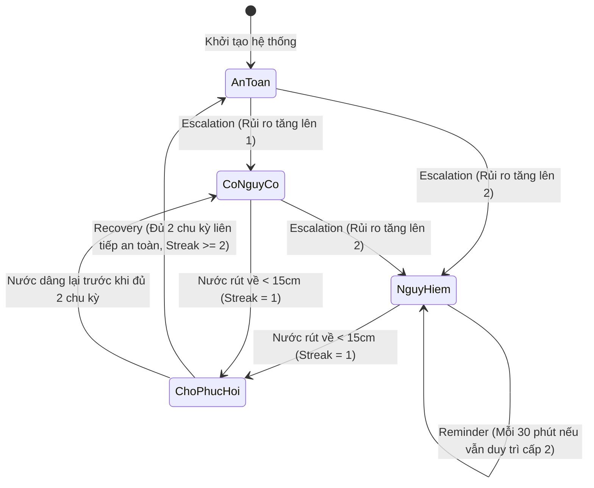

# BÁO CÁO NGHIÊN CỨU KHOA HỌC KỸ THUẬT
# HỆ THỐNG AI–IoT DỰ BÁO SỚM NGUY CƠ NGẬP LỤT CỤC BỘ TẠI KHU VỰC TRƯỜNG HỌC VÀ ĐÔ THỊ

> **Tài liệu chuẩn bị cho:** Đề án Cuộc thi Khoa học Kỹ thuật / Trình duyệt Ban Giám hiệu  
> **Liên kết Google Docs:** `https://docs.google.com/document/d/1wAQIVk8ZPgR4LHY94oAhMgj-2SliOxVTHJbj61yCKnU`  
> **Lĩnh vực:** Hệ thống nhúng & Trí tuệ nhân tạo (Embedded Systems & Artificial Intelligence)  
> **Cơ quan/Đơn vị thực hiện:** Nhóm nghiên cứu Học sinh – Giáo viên hướng dẫn  

---

# PHẦN 1: BẢN THUYẾT MINH ĐỀ TÀI (PROPOSAL)
*(Phiên bản ngôn ngữ đại chúng – Hạn chế tối đa thuật ngữ kỹ thuật phức tạp)*

---

## 1.1. Xuất phát điểm từ thực tế: Nỗi lo ngập lụt mỗi mùa mưa bão
Hội An và các tỉnh ven biển miền Trung là nơi thường xuyên gánh chịu những đợt mưa lớn dồn dập kết hợp với triều cường và xả lũ từ thượng nguồn. Tại các trường học và khu dân cư trũng thấp:
- Nước lũ dâng rất nhanh: Có những thời điểm chỉ sau 30 đến 45 phút mưa xối xả, cống thoát nước bị quá tải, nước từ ngoài đường và rãnh thoát nước đã tràn vào sân trường, ngập sâu nửa mét.
- Thiệt hại lớn và nguy cơ mất an toàn:
  - Học sinh và giáo viên bị kẹt lại trong trường, đường về nhà bị chia cắt nguy hiểm.
  - Phòng máy vi tính, thư viện sách, hồ sơ học bạ và các thiết bị thí nghiệm ở tầng 1 không kịp kê kích, gây hư hỏng hàng trăm triệu đồng.
  - Sau lũ, việc dọn rửa bùn non kéo dài làm gián đoạn việc học tập của hàng ngàn học sinh.

## 1.2. Điểm yếu của cách làm truyền thống hiện nay
1. **Bản tin thời tiết quá chung chung:** Các đài khí tượng thường chỉ dự báo cho toàn tỉnh hoặc toàn thành phố. Tuy nhiên, ngập lụt cục bộ mang tính chất "từng điểm": Có thể đầu phố chưa ngập nhưng sân trường ở chỗ trũng đã bì bõm nước.
2. **Bị động chạy theo con nước:** Thầy cô và bác bảo vệ chỉ biết nước ngập khi "mắt thấy chân chạm nước". Lúc này, việc di chuyển hàng chục dàn máy tính hay gọi phụ huynh đến đón học sinh đã trở nên hỗn loạn và muộn màng.
3. **Kinh nghiệm dân gian không còn theo kịp biến đổi khí hậu:** Mưa bão ngày càng bất thường với những trận mưa cực đoan có cường độ kỷ lục, khiến kinh nghiệm quan sát mây trời truyền thống dễ dẫn đến phán đoán sai.

## 1.3. Ý tưởng sáng tạo: "Bác bảo vệ công nghệ" túc trực 24/7
Đề tài ra đời với mục tiêu chế tạo một **Hệ thống cảnh báo sớm mini, thông minh và giá rẻ**, hoạt động khép kín từ khâu đo đạc tại chỗ đến gửi tin nhắn cảnh báo về điện thoại của thầy cô Ban Giám hiệu:
- Đặt một "trạm gác mini" ngay tại miệng cống rãnh hoặc góc trũng nhất của sân trường.
- Thiết bị tự động đo xem **trời đang mưa lớn cỡ nào** và **mực nước dưới rãnh đang dâng lên nhanh hay chậm**.
- "Bộ não AI" được cài đặt sẵn sẽ phân tích các dấu hiệu này để **dự báo trước 15 phút và 30 phút**: Nước có tràn lên sân trường hay không?
- Khi phát hiện nguy cơ, hệ thống **tự động gửi tin nhắn báo động qua Telegram** tới điện thoại của thầy hiệu trưởng, giáo viên chủ nhiệm và phụ huynh để mọi người chủ động hành động trước khi quá muộn.

## 1.4. Hiểu về "Trí Tuệ Nhân Tạo (AI) Dự Báo Ngập" một cách mộc mạc nhất
Nhiều người nghĩ AI là một thứ gì đó rất cao siêu, xa vời. Nhưng trong đề tài này, AI hoạt động giống như một **bác bảo vệ trường học có thâm niên 30 năm quan sát lũ**:
- Bác bảo vệ dày dạn kinh nghiệm luôn biết rằng: *"Nếu mưa rào tầm tã liên tục 5 phút mà thấy nước dưới cống nhảy vọt lên 3 phân, thì chắc chắn chỉ 15 phút nữa sân trường sẽ ngập trắng"*.
- AI trong hệ thống này cũng vậy: Chúng em cho máy tính học hàng trăm kịch bản mưa ngập thực tế. Máy tính ghi nhớ quy luật tương quan giữa:
  1. Độ to của hạt mưa rơi xuống.
  2. Mức nước đang dâng ở thời điểm hiện tại.
  3. Tốc độ dâng nhanh hay chậm của dòng nước trong 2 phút vừa qua.
- Nhờ khả năng tính toán không ngừng nghỉ, AI liên tục "nhìn vào hiện tại" để "đoán trước tương lai 15 và 30 phút" với độ chính xác rất cao, không bao giờ biết mệt mỏi hay lơ là.

## 1.5. Hệ thống cảnh báo 3 cấp độ màu trực quan như đèn giao thông

Để ai cũng có thể hiểu ngay lập tức mà không cần đọc những con số phức tạp, hệ thống phân chia tình trạng ngập lụt thành 3 mức độ rõ ràng:

| Cấp độ | Màu sắc | Tình trạng thực tế | Dự báo của hệ thống | Hành động khuyến nghị cho nhà trường |
| :---: | :---: | :--- | :--- | :--- |
| **Mức 0** | 🟢 **XANH** | **Bình thường (An toàn)**<br>Trời nắng ráo hoặc mưa nhỏ, nước trong cống thấp dưới 15 cm. | 15–30 phút tới hoàn toàn an toàn, nước không thể tràn. | Thầy cô và học sinh dạy học bình thường. Không gửi cảnh báo làm phiền. |
| **Mức 1** | 🟡 **VÀNG** | **Có nguy cơ (Cảnh giác)**<br>Mưa bắt đầu nặng hạt, nước dâng đến nửa hố ga ($15 - 25\text{ cm}$). | Dự báo 15–30 phút tới nước có khả năng mấp mé miệng rãnh. | Bác bảo vệ kiểm tra rác chắn miệng cống; thầy cô chuẩn bị phương án kê đồ dùng nếu mưa tiếp tục to. |
| **Mức 2** | 🔴 **ĐỎ** | **Nguy hiểm cao (Khẩn cấp)**<br>Mưa xối xả, nước dâng vượt 25 cm và đang dâng rất nhanh. | Dự báo chắc chắn trong 15–30 phút tới nước tràn ngập toàn bộ sân trường. | **[HÀNH ĐỘNG NGAY]** Ngắt cầu dao điện tầng 1; chuyển máy tính, thiết bị lên tầng cao; phát thông báo cho học sinh di chuyển lên lầu hoặc thông báo phụ huynh đón sớm. |

## 1.6. Tính nhân văn và ý nghĩa thực tiễn của đề tài
1. **Ưu tiên cao nhất là an toàn tính mạng con người:**
   - 15 đến 30 phút báo trước là "thời gian vàng" đủ để sơ tán học sinh khỏi khu vực nguy hiểm, tránh được tai nạn trượt chân ngã xuống cống hoặc điện giật dưới nước lũ.
2. **Bảo vệ tài sản nhà nước và nhà trường:**
   - Cứu vãn hàng trăm triệu đồng thiết bị điện tử, sách vở chỉ bằng việc kích hoạt cảnh báo sớm để kịp kê kích lên cao.
3. **Chi phí chế tạo cực kỳ tiết kiệm (dưới 1 triệu đồng/trạm):**
   - Sử dụng các linh kiện điện tử thông dụng, dễ tìm, chi phí chỉ bằng một bữa liên hoan nhỏ của lớp nhưng mang lại sự an tâm cho cả ngôi trường suốt mùa mưa bão.
4. **Khả năng triển khai rộng khắp:**
   - Có thể nhân rộng mô hình này đến mọi trường tiểu học, mầm non, trạm y tế xã, hoặc các con hẻm trũng thấp trong toàn thành phố Hội An và cả nước.


---

# PHẦN 2: BÁO CÁO VÀ ĐẶC TẢ KỸ THUẬT CHUYÊN SÂU (TECHNICAL SPECIFICATION)
*(Dành cho Hội đồng Giám khảo chuyên môn, Kỹ sư phần mềm & Chuyên gia IoT)*

---

## 2.1. Kiến trúc hệ thống toàn trình (End-to-End System Architecture)

Hệ thống được thiết kế theo mô hình 5 tầng khép kín (Closed-loop Architecture), đảm bảo tính thời gian thực (Real-time), phân tách trách nhiệm rõ ràng (Separation of Concerns) và độ tin cậy công nghiệp:

```
┌────────────────────────────────────────────────────────────────────────┐
│ 1. SENSING LAYER (Tầng Cảm biến & Vi điều khiển)                       │
│    - ESP32 Dual-Core (FreeRTOS)                                        │
│    - Cảm biến siêu âm HC-SR04 / JSN-SR04T (Khoảng cách nước)           │
│    - Cảm biến đo mưa Tipping Bucket / Điện dung                        │
│    - Bộ nhớ đệm ngoại tuyến SPIFFS / Circular RAM Buffer (chống rớt mạng)│
└───────────────────────────────────┬────────────────────────────────────┘
                                    │ HTTP POST (Mỗi 60s, X-Device-Key)
                                    ▼
┌────────────────────────────────────────────────────────────────────────┐
│ 2. TRANSPORT & INGESTION LAYER (Tầng Thu nhận & Truyền dẫn)            │
│    - FastAPI Async RESTful Gateway                                     │
│    - Xác thực bảo mật trạm đo qua Token-based Security (`X-Device-Key`) │
│    - Realtime Broadcasting: Server-Sent Events (SSE) & WebSocket       │
└───────────────────────────────────┬────────────────────────────────────┘
                                    │
                                    ▼
┌────────────────────────────────────────────────────────────────────────┐
│ 3. STORAGE & FEATURE PIPELINE (Tầng Dữ liệu & Đặc trưng)               │
│    - Cơ sở dữ liệu SQLite3 (Chế độ WAL - Write-Ahead Logging)          │
│    - Cửa sổ trượt thời gian (Sliding Time Window): W = 15 phút          │
│    - Trích xuất 4 vector đặc trưng thủy lực tức thời                   │
└───────────────────────────────────┬────────────────────────────────────┘
                                    │
                                    ▼
┌────────────────────────────────────────────────────────────────────────┐
│ 4. AI INFERENCE & SAFETY GATE LAYER (Tầng Suy luận & Lưới An toàn)     │
│    - Dual Multinomial Logistic Regression Pipeline (15m & 30m)         │
│    - Scikit-Learn Pipeline: StandardScaler + Multinomial Softmax       │
│    - Safety Gate: Baseline Rule-based làm hàng rào an toàn kép          │
└───────────────────────────────────┬────────────────────────────────────┘
                                    │
                                    ▼
┌────────────────────────────────────────────────────────────────────────┐
│ 5. NOTIFICATION & OBSERVABILITY LAYER (Tầng Cảnh báo & Vận hành)       │
│    - Stateful Alert Engine: Escalation, Reminder (30m), Recovery (streak 2)│
│    - Worker đa luồng gửi tin bất đồng bộ: Telegram Bot API & SMTP      │
│    - Trực quan hóa dữ liệu vận hành: Dashboard Streamlit thời gian thực │
└────────────────────────────────────────────────────────────────────────┘
```

## 2.2. Không gian đặc trưng toán học (Mathematical Feature Formulation)

Tại mỗi chu kỳ quan trắc rời rạc $t \in \mathbb{N}$ (chu kỳ lấy mẫu chuẩn $T = 60\text{ giây}$), hệ thống trích xuất một vector đặc trưng gồm 4 chiều $\mathbf{x}_t \in \mathbb{R}^4$:

$$\mathbf{x}_t = \begin{bmatrix} x_{1,t} \\ x_{2,t} \\ x_{3,t} \\ x_{4,t} \end{bmatrix} = \begin{bmatrix} \text{rain\_rate\_mmh}(t) \\ \text{rain\_sum\_5m}(t) \\ \text{water\_level\_cm}(t) \\ \text{water\_rise\_2m\_cm}(t) \end{bmatrix}$$

### Chi tiết các thành phần toán học:
1. **$x_{1,t}$ - Cường độ mưa tức thời ($\text{mm/h}$):**  
   Đại diện cho xung lượng nước mưa hiện tại tác động trực tiếp lên bề mặt.
2. **$x_{2,t}$ - Lượng mưa tích lũy 5 phút gần nhất ($\text{mm}$):**  
   Biểu diễn lượng nước dồn ứ chưa kịp thấm hoặc thoát:
   $$x_{2,t} = \sum_{k=0}^{4} \text{rain\_interval\_mm}(t - k)$$
3. **$x_{3,t}$ - Mực nước tuyệt đối tại hố ga ($\text{cm}$):**  
   Xác định trực tiếp từ độ sâu đo được bởi cảm biến siêu âm $d(t)$:
   $$x_{3,t} = H_{\text{total}} - d(t) = 40.0 - d(t)$$
4. **$x_{4,t}$ - Tốc độ dâng nước 2 phút gần nhất ($\text{cm/2 phút}$):**  
   Xấp xỉ đạo hàm bậc 1 theo thời gian rời rạc của mực nước:
   $$x_{4,t} = x_{3,t} - x_{3,t-2}$$

> [!NOTE]
> **Bộ đệm cửa sổ trượt (Warmup Period):** Để đảm bảo tính hội tụ và triệt tiêu tính bất định ban đầu, hệ thống yêu cầu tối thiểu $W_{\text{warmup}} = 15$ chu kỳ đo (15 phút) liên tục. Trong 15 phút đầu tiên, API trả về trạng thái `warming_up` và chỉ chuyển sang trạng thái phân loại `valid` khi cửa sổ đã lấp đầy.

## 2.3. Mô hình học máy Multinomial Logistic Regression

Nhóm nghiên cứu lựa chọn thuật toán **Multinomial Logistic Regression** (Hồi quy Logistic đa lớp) cho bài toán phân loại nguy cơ ngập cục bộ 3 lớp:
$$\mathcal{Y} = \{0: \text{An toàn}, 1: \text{Có nguy cơ}, 2: \text{Nguy hiểm cao}\}$$

### Hàm phân phối xác suất Softmax:
Với mỗi khoảng dự báo tương lai $H \in \{15, 30\}$ phút, xác suất có điều kiện thuộc về lớp $k \in \{0, 1, 2\}$ được tính bởi:

$$P(Y_H = k \mid \mathbf{x}_t) = \frac{\exp\left(\mathbf{w}_{H,k}^T \tilde{\mathbf{x}}_t + b_{H,k}\right)}{\sum_{j=0}^{2} \exp\left(\mathbf{w}_{H,j}^T \tilde{\mathbf{x}}_t + b_{H,j}\right)}$$

Trong đó:
- $\tilde{\mathbf{x}}_t = \frac{\mathbf{x}_t - \boldsymbol{\mu}}{\boldsymbol{\sigma}}$ là vector đặc trưng đã được chuẩn hóa qua `StandardScaler`.
- $\mathbf{w}_{H,k} \in \mathbb{R}^4$ và $b_{H,k} \in \mathbb{R}$ lần lượt là vector trọng số và độ lệch (bias) tương ứng với lớp $k$.
- Nhãn dự báo cuối cùng là lớp có xác suất cực đại (Bayes Optimal Classifier):
  $$\hat{y}_{H} = \arg\max_{k \in \{0, 1, 2\}} P(Y_H = k \mid \mathbf{x}_t)$$

### Chiến lược tối ưu hóa hàm mất mát:
Hàm mất mát Log-loss đa lớp kết hợp chuẩn hóa $L_2$ (Ridge Regularization):
$$\mathcal{L}(\mathbf{W}_H, \mathbf{b}_H) = - \frac{1}{N} \sum_{i=1}^{N} \sum_{k=0}^{2} \mathbb{I}(y_i = k) \ln P(Y = k \mid \mathbf{x}_i) + \frac{1}{2C} \sum_{k=0}^{2} \|\mathbf{w}_{H,k}\|_2^2$$

- Sử dụng cơ chế cân bằng trọng số lớp `class_weight='balanced'` để tự động nhân trọng số tỷ lệ nghịch với tần suất xuất hiện của lớp, loại bỏ hiện tượng mô hình thiên lệch về lớp An toàn (Safe) do dữ liệu ngập nước thường hiếm hơn dữ liệu khô ráo.

## 2.4. Hàng rào an toàn kép (Safety Gate & Baseline Predictor)

Một nguyên tắc sống còn trong các hệ thống AI ứng dụng cảnh báo thiên tai là: **Tuyệt đối không để AI hành xử như một "hộp đen" mất kiểm soát (Uncontrolled Black-box).**

Hệ thống Mini Flood V1 thiết kế mô hình cơ sở theo quy tắc ngưỡng vật lý (Baseline Predictor):
- Tính toán mực nước dự phóng ngoại suy tuyến tính:
  $$\hat{h}_{\text{extrap}} = x_{3,t} + \frac{x_{4,t}}{2} \times H$$
- Gán nhãn cơ sở:
  $$\hat{y}_{\text{baseline}} = \begin{cases}
  0 & \text{khi } \hat{h}_{\text{extrap}} < 15.0\text{ cm} \\
  1 & \text{khi } 15.0 \le \hat{h}_{\text{extrap}} < 25.0\text{ cm} \\
  2 & \text{khi } \hat{h}_{\text{extrap}} \ge 25.0\text{ cm}
  \end{cases}$$

### Lưới kiểm định Safety Gate khi nạp mô hình:
Mô hình AI huấn luyện trên dữ liệu thật chỉ được kích hoạt nếu vượt qua vòng nghiệm thu khắt khe so với Baseline:
1. $\text{Macro-F1}_{\text{AI}} > \text{Macro-F1}_{\text{Baseline}}$ trên cả 2 horizon 15 phút và 30 phút.
2. $\text{Recall}_{\text{Danger (AI)}} \ge \text{Recall}_{\text{Danger (Baseline)}}$ (đảm bảo AI không bỏ lọt các trường hợp ngập sâu mà quy tắc vật lý cơ bản nhận diện được).
3. Nếu mô hình chưa hội tụ hoặc gặp lỗi dữ liệu, API tự động hạ cấp về Baseline một cách trong suốt (Graceful Degradation).

## 2.5. Cơ chế điều tiết cảnh báo thông minh (Stateful Alert Engine)

Hệ thống tích hợp máy trạng thái hữu hạn (Finite State Machine) lưu vết trong SQLite (`alert_state:{device_id}`) nhằm giải quyết triệt để vấn đề "bão thông báo" (Alert Fatigue/Spam):



- **Leo thang (Escalation):** Gửi cảnh báo lập tức qua Telegram trong vòng $\le 15$ giây từ lúc phát hiện nguy cơ.
- **Nhắc lại (Reminder):** Định kỳ gửi lại sau mỗi 30 phút nếu trạng thái nguy hiểm vẫn tiếp diễn.
- **Phục hồi (Recovery):** Bắt buộc duy trì liên tiếp 2 chu kỳ đo an toàn ($\ge 2$ phút) mới hạ cấp cảnh báo, ngăn chặn tình trạng sóng nước nhấp nhô mấp mé ngưỡng kích hoạt gửi tin nhắn liên tục.


---

# PHẦN 3: PHÂN TÍCH KHÁI NIỆM HỆ THỐNG VÀ GIẢI PHẪU CHI TIẾT THIẾT BỊ IoT
*(Phân tích cơ chế hoạt động, nguyên lý vật lý và giải phẫu phần cứng chuyên sâu)*

---

## 3.1. Phân tích các khái niệm khoa học cốt lõi của hệ thống

Để xây dựng một hệ thống AI–IoT hoạt động ổn định trong điều kiện khắc nghiệt của mùa mưa bão, nhóm nghiên cứu đã làm rõ và chuẩn hóa 5 khái niệm khoa học trọng tâm:

### 1. Khái niệm "Telemetry" (Dữ liệu quan trắc từ xa)
- **Định nghĩa:** Telemetry là quá trình tự động thu thập dữ liệu đo đạc tại các điểm quan trắc vật lý từ xa và truyền về hệ thống trung tâm mà không cần sự can thiệp của con người.
- **Bản tin Telemetry trong đề tài:** Không chỉ đơn thuần là gửi một con số mực nước, một gói tin telemetry chuẩn bao gồm:
  - `device_id`: Định danh trạm đo (đảm bảo không bị giả mạo hoặc nhầm lẫn giữa các trạm).
  - `sequence_no`: Số thứ tự gói tin tăng dần (giúp phát hiện mất gói hoặc gói tin đến trễ).
  - `timestamp`: Thời điểm đo theo chuẩn thời gian phối hợp quốc tế (ISO 8601 UTC).
  - `rain_rate_mmh` & `rain_interval_mm`: Thông số mưa tức thời và mưa chu kỳ.
  - `water_level_cm`: Mực nước chuẩn hóa đã trừ độ sâu hố ga.
  - `quality_flags`: Cờ trạng thái chất lượng cảm biến (bình thường, nghi ngờ, lỗi cảm biến).

### 2. Khái niệm "Cửa sổ trượt thời gian" (Sliding Time Window)
- Trong thủy lực học, hiện tượng ngập lụt luôn có **độ trễ tích lũy** (Hydrological Lag Time): Mưa xối xả rơi xuống mái nhà và mặt đường phải mất từ 3 đến 10 phút mới dồn vào rãnh cống; đất ngấm no nước thì tốc độ dâng mới tăng vọt.
- Nếu chỉ nhìn vào một thời điểm đo duy nhất tại phút thứ $t$, hệ thống hoàn toàn "mù" trước xu thế. Vì vậy, hệ thống sử dụng cửa sổ trượt $W = 15\text{ phút}$:
  - Tại phút thứ $t$, hệ thống nhìn lại chuỗi lịch sử từ $[t - 14, t]$ để tính toán tốc độ gia tăng mực nước ($\Delta h$) và tổng lượng mưa tích lũy. Cửa sổ này liên tục tịnh tiến theo từng phút, cung cấp ngữ cảnh động đầy đủ cho mô hình AI.

### 3. Khái niệm "Khoảng thời gian dự báo trước" (Lead Horizon: 15m & 30m)
- Khác với hệ thống giám sát thụ động (chỉ báo khi nước đã ngập), hệ thống AI giải bài toán **Dự báo trước tương lai (Look-ahead Prediction)**:
  - **Cửa sổ 15 phút (Lead 15m):** Phục vụ cho **phản ứng tác thuật tức thì** (Tactical Response) – Ngắt cầu dao điện tầng trệt, kê kích bàn ghế và thiết bị thí nghiệm phòng máy tính.
  - **Cửa sổ 30 phút (Lead 30m):** Phục vụ cho **quyết định chiến lược** (Strategic Decision) – Ban Giám hiệu quyết định cho học sinh di chuyển lên các phòng học tầng 2, hoặc phát tin nhắn khẩn cấp cho phụ huynh không đưa đón con em qua các đoạn đường ngập sâu.

### 4. Khái niệm "Suy luận tại biên" (Edge) so với "Máy chủ trung tâm" (Server)
- **Thiết kế phân tầng hợp lý:**
  - Vi điều khiển tại trạm (ESP32) tập trung toàn bộ tài nguyên vào việc **đo đạc chính xác, lọc nhiễu tín hiệu và truyền tin ổn định**.
  - Laptop / Máy chủ nội bộ phụ trách **lưu trữ cơ sở dữ liệu lớn, tính toán đặc trưng chuỗi thời gian, suy luận mô hình AI và gửi thông báo qua mạng**.
  - Thiết kế này giúp thiết bị đo tại trạm hoạt động bền bỉ, tiêu thụ cực ít điện năng, không bị quá nhiệt hay treo máy khi phải gánh các thuật toán toán học nặng nề.

### 5. So sánh "Học Máy (Machine Learning)" và "Quy tắc ngưỡng cố định (Rule-based)"
| Tiêu chí so sánh | Quy tắc ngưỡng cố định (Rule-based: If-Else) | Mô hình Học Máy AI (Logistic Regression) |
|---|---|---|
| **Cơ chế phản ứng** | Phản ứng thụ động: Chỉ báo động khi mực nước đã thực sự vượt qua vạch 15cm hoặc 25cm. | Dự báo chủ động: Có thể phát cảnh báo nguy hiểm ngay khi nước mới ở 10cm nếu nhận thấy mưa cực lớn và tốc độ dâng đang tăng vọt. |
| **Độ nhạy ngữ cảnh** | Cứng nhắc, không phân biệt được nước dâng do mưa rào bất chợt hay mưa dầm tích lũy. | Học được tương quan phi tuyến giữa lượng mưa dồn ứ 5 phút và đạo hàm tốc độ dâng nước. |
| **Khả năng thích ứng** | Muốn thay đổi phải sửa code thủ công cho từng địa hình. | Dễ dàng tái huấn luyện (Retrain) khi chuyển trạm đo sang hố ga có kích thước hoặc độ dốc khác. |

---

## 3.2. Giải phẫu chi tiết phần cứng và thiết bị IoT

```
                    ┌─────────────────────────────────────────┐
                    │      HỘP BẢO VỆ CHỐNG NƯỚC IP65         │
                    │                                         │
                    │   ┌─────────────────────────────────┐   │
                    │   │        ESP32 DEVKIT V1          │   │
                    │   │  - Dual Core 240MHz             │   │
                    │   │  - Wi-Fi 802.11 b/g/n           │   │
                    │   │  - 4MB Flash (SPIFFS Buffer)    │   │
                    │   └───────┬─────────────────┬───────┘   │
                    └───────────┼─────────────────┼───────────┘
                                │                 │
               GPIO 4 (Echo)   │                 │ GPIO 34 (Analog)
               GPIO 5 (Trig)   │                 │ GPIO 35 (Digital)
                                ▼                 ▼
                    ┌──────────────────┐  ┌──────────────────┐
                    │ CẢM BIẾN SIÊU ÂM │  │  CẢM BIẾN ĐO MƯA │
                    │ JSN-SR04T/HC-SR04│  │  Tipping Bucket  │
                    │ (Chống nước IP67)│  │ (Đo xung gầu lật)│
                    └──────────────────┘  └──────────────────┘
```

### 1. Vi điều khiển trung tâm: ESP32 DevKit V1 (38 chân)
- **Trái tim xử lý:** Sử dụng chip vi xử lý 32-bit Dual-Core Tensilica Xtensa LX6, xung nhịp hoạt động lên tới $240\text{ MHz}$, hiệu năng tính toán đạt $600\text{ DMIPS}$.
- **Hệ thống truyền thông tích hợp:** Hỗ trợ chuẩn Wi-Fi $802.11\text{ b/g/n}$ công suất phát $+20\text{ dBm}$, tích hợp ăng-ten PCB trên bo mạch, cho cự ly bắt sóng xa từ sân trường tới bộ phát Wi-Fi phòng bảo vệ lên tới $50 - 70\text{ mét}$.
- **Hệ điều hành thời gian thực (FreeRTOS):** Cho phép vi điều khiển phân tách các luồng công việc độc lập: một lõi chuyên quét cảm biến theo thời gian thực chính xác từng micro-giây, lõi còn lại xử lý kết nối Wi-Fi và gửi HTTP POST.
- **Cơ chế lưu đệm ngoại tuyến (Offline Flash Buffer - SPIFFS):**
  - Khi bão lớn làm đứt đường truyền Wi-Fi, trạm đo không bị gián đoạn hay mất dữ liệu.
  - Firmware tự động kích hoạt bộ đệm lưu trữ dữ liệu thô vào chip nhớ Flash dung lượng $4\text{ MB}$. Khi mạng Wi-Fi được khôi phục, trạm đo tự động gửi bù toàn bộ các gói tin tích lũy về máy chủ (Batch Ingestion).

### 2. Cảm biến siêu âm đo mực nước: HC-SR04 / JSN-SR04T
- **Nguyên lý đo vật lý (Acoustic Time-of-Flight):**
  1. Vi điều khiển phát một xung điện $10\mu\text{s}$ vào chân `Trigger`.
  2. Cảm biến phát ra một chùm 8 chu kỳ sóng siêu âm ở tần số $40\text{ kHz}$ (tai người không nghe thấy).
  3. Sóng âm truyền qua không khí đập vào mặt nước và dội ngược trở lại đầu thu.
  4. Chân `Echo` mở mức logic HIGH trong khoảng thời gian $\Delta t$ đúng bằng thời gian sóng đi và về.
  5. Khoảng cách được tính theo công thức động học:
     $$d = \frac{v_{\text{sound}} \times \Delta t}{2}$$
     *(với $v_{\text{sound}} \approx 343\text{ m/s}$ tại nhiệt độ môi trường $20^\circ\text{C}$)*.

- **Đặc tính kỹ thuật & Giải pháp công nghệ xử lý nhiễu:**
  - **Tầm đo:** Từ $2\text{ cm}$ đến $400\text{ cm}$, độ phân giải đạt $0.3\text{ cm}$.
  - **Vùng mù (Blind Zone):** Trong khoảng cự ly $< 2\text{ cm}$, sóng âm phản xạ về quá nhanh khi đầu phát chưa kịp chuyển sang trạng thái thu, dẫn đến giá trị đo bị sai lệch.  
    *Giải pháp:* Nhóm nghiên cứu thiết kế giá đỡ đặt đầu cảm biến cao hơn mép trên của hố ga $5\text{ cm}$.
  - **Hiện tượng dội âm thành giếng (Wall Reflection):** Góc mở chùm sóng âm là $15^\circ$. Trong lòng hố ga hẹp, sóng âm có thể va chạm vào thành bê tông gây tín hiệu giả.  
    *Giải pháp:* Đặt cảm biến chính xác tại tâm đối xứng của miệng hố ga và áp dụng **Thuật toán lọc trung vị (Median Filter 5 mẫu)** trong firmware: Lấy 5 lần đo liên tiếp trong 2 giây, sắp xếp thứ tự và lấy giá trị ở giữa để loại bỏ hoàn toàn các đỉnh sóng nhiễu dị biệt do bọt nước hoặc dội thành.

### 3. Cảm biến đo mưa: Cơ chế Gầu lật (Tipping Bucket) & Mạch trở kháng
- **Cảm biến Gầu lật (Tipping Bucket):**
  - Nước mưa được hứng qua phễu chuẩn có đường kính xác định dẫn vào một chiếc gầu cân bằng hai ngăn.
  - Khi một ngăn tích đủ $0.2\text{ mm}$ nước mưa, trọng lực làm gầu lật nghiêng, kích hoạt một nam châm nhỏ quét qua công tắc từ (Reed Switch).
  - Công tắc từ đóng mạch tạo ra một xung logic gửi về chân ngắt phần cứng (Hardware Interrupt GPIO 35) của ESP32.
  - Số lần ngắt trong 1 phút nhân với $0.2\text{ mm}$ cho ra lượng mưa tích lũy và cường độ mưa $\text{mm/h}$ với độ chính xác cao tương đương trạm khí tượng chuyên nghiệp.
- **Cảm biến màng điện trở (Rain Board):**
  - Sử dụng các đường mạch in mạ niken đan xen. Khi hạt mưa rơi vào, nước đóng vai trò chất dẫn điện làm suy giảm điện trở bề mặt.
  - Tín hiệu điện áp analog qua bộ chuyển đổi ADC 12-bit trên ESP32 cho phép phát hiện tức thì giọt mưa đầu tiên ngay trong 1-2 giây, kích hoạt trạm đo chuyển từ trạng thái nghỉ (Sleep) sang chế độ đo tích cực.

### 4. Thiết kế mạch nguồn và Vỏ bảo vệ thực địa (Field Packaging)
- **Bộ nguồn chống sụt áp:**
  - Mô-đun Wi-Fi của ESP32 có đặc tính tiêu thụ dòng đột biến (đỉnh xung lên tới $500\text{ mA}$) trong vài mili-giây khi phát gói tin RF.
  - Thiết kế bổ sung tụ điện hóa dung lượng lớn $1000\mu\text{F} / 16\text{V}$ và tụ gốm $100\text{nF}$ mắc song song ngay cạnh chân nguồn $V_{\text{in}}$ của ESP32 để lọc sạch xung nhiễu và ngăn ngừa hiện tượng sụt áp gây khởi động lại vi điều khiển (Brownout Reset).
- **Hộp bảo vệ chuẩn công nghiệp:**
  - Bo mạch trung tâm đặt trong hộp nhựa ABS chống cháy đạt chuẩn kháng nước **IP65**.
  - Đầu cảm biến siêu âm phía dưới hố ga sử dụng phiên bản chống nước chuyên dụng **JSN-SR04T** đạt chuẩn **IP67** (đầu dò bọc kín kim loại chống ẩm mốc và khí ga ăn mòn từ lòng cống).

### 5. Giao thức cảnh báo Telegram Bot API
- **Tại sao chọn Telegram thay vì SMS truyền thống?**
  1. **Tốc độ cực nhanh và tin cậy:** Tin nhắn qua giao thức HTTP/TLS của Telegram đến tay người dùng trong vòng $1 - 2\text{ giây}$.
  2. **Hỗ trợ thông báo theo Nhóm (Group Alert):** Cho phép toàn bộ thành viên Ban Giám hiệu, Ban Chỉ huy Phòng chống thiên tai trường học và kíp trực bảo vệ cùng nhận tin nhắn đồng thời.
  3. **Không tốn chi phí cước viễn thông:** Hoạt động hoàn toàn qua Internet (Wi-Fi / 4G), tiết kiệm kinh phí duy trì hàng tháng cho nhà trường.
  4. **Khả năng định dạng phong phú:** Hiển thị trực quan mức độ rủi ro, xác suất tính toán của AI, mực nước hiện tại và các khuyến nghị hành động khẩn cấp.
