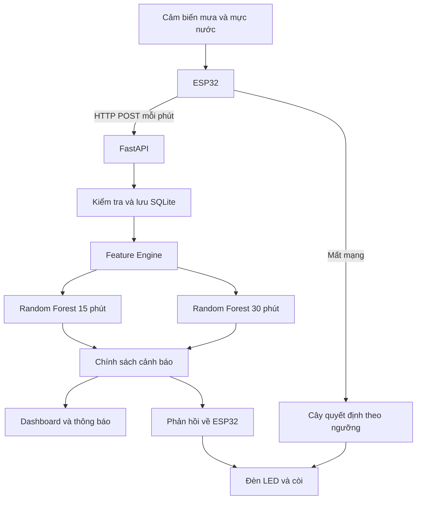

# Đề xuất hệ thống AI–IoT dự báo nguy cơ ngập cục bộ

## 1. Tóm tắt đề tài

Đề tài xây dựng một prototype AI–IoT dự báo nguy cơ ngập cục bộ tại một hố ga hoặc rãnh thoát nước trường học trước **15 phút và 30 phút**.

Hệ thống sử dụng:

- Cảm biến mưa.
- Cảm biến siêu âm đo mực nước.
- ESP32 thu thập và truyền dữ liệu.
- FastAPI và SQLite chạy trên laptop.
- Random Forest làm mô hình dự báo chính.
- Cây quyết định theo ngưỡng chạy trên ESP32 làm lớp an toàn dự phòng.
- Đèn LED, còi, dashboard và thông báo cho người dùng.

> **Mục tiêu ưu tiên:** Hoàn thành một vòng hoạt động khép kín từ cảm biến đến cảnh báo, có thể chạy ổn định và trình diễn trực tiếp.

---

## 2. Phạm vi phiên bản 1

### Trong phạm vi

- Một mô hình vật lý mô phỏng hố ga hoặc rãnh thoát nước sâu 40 cm.
- Một ESP32 và hai loại cảm biến.
- Dữ liệu được đo theo chu kỳ một phút.
- Dự báo nguy cơ ngập trước 15 phút và 30 phút.
- Truyền dữ liệu bằng HTTP qua Wi-Fi.
- Backend chạy trên laptop và lưu dữ liệu bằng SQLite.
- Ba mức cảnh báo: An toàn, Có nguy cơ và Nguy hiểm cao.
- Cảnh báo tại chỗ bằng đèn và còi.

### Ngoài phạm vi

- Dự báo ngập cho từng phường hoặc toàn thành phố Hội An.
- Dự báo từ 1 đến 3 giờ.
- Lưu lượng sông Thu Bồn.
- Dữ liệu xả lũ thủy điện.
- Mực triều và nước biển dâng.
- GloFAS, ảnh vệ tinh và bản đồ ngập.
- Vận hành như một hệ thống cảnh báo thiên tai thực tế.

Tất cả dashboard và thông báo phải ghi rõ:

```text
[MÔ PHỎNG THỬ NGHIỆM]
```

Kết quả của V1 không đại diện cho dự báo ngập toàn Hội An.

---

## 3. Mục tiêu cần đạt

1. Đo cường độ mưa và mực nước theo chu kỳ một phút.
2. Tính tốc độ dâng nước trong 5 phút.
3. Tính lượng mưa tích lũy trong 15 phút.
4. Dự báo ba mức rủi ro cho 15 phút và 30 phút tiếp theo.
5. Điều khiển đèn và còi theo mức cảnh báo cuối cùng.
6. Lưu dữ liệu phục vụ kiểm tra và tái huấn luyện.
7. Trình diễn được cả chế độ trực tuyến và chế độ mất Wi-Fi.

---

## 4. Đầu vào của mô hình AI

Hai cảm biến tạo ra bốn tham số chính:

| Tham số | Nguồn | Ý nghĩa | Đơn vị |
|---|---|---|---|
| `water_level_cm` | Cảm biến siêu âm | Mực nước hiện tại trong hố ga | cm |
| `water_rise_5m_cm` | Tính từ lịch sử mực nước | Mức tăng của mực nước trong 5 phút | cm/5 phút |
| `rain_rate_mmh` | Cảm biến mưa | Cường độ mưa tức thời | mm/giờ |
| `rain_sum_15m` | Tính từ lịch sử lượng mưa | Tổng lượng mưa trong 15 phút gần nhất | mm |

ESP32 gửi giá trị đo thô. Backend sử dụng lịch sử các bản ghi để tính `water_rise_5m_cm` và `rain_sum_15m` trước khi gọi model.

---

## 5. Kiến trúc hệ thống



### Luồng xử lý

1. Cảm biến đo mưa và mực nước.
2. ESP32 gửi dữ liệu đến `POST /api/v1/telemetry` mỗi phút.
3. Backend kiểm tra dữ liệu và chống bản ghi trùng.
4. Dữ liệu hợp lệ được lưu vào SQLite.
5. Feature Engine lấy lịch sử để tạo bốn đầu vào cho AI.
6. Hai model Random Forest dự báo cho 15 phút và 30 phút.
7. Backend kết hợp kết quả AI với ngưỡng an toàn.
8. Mức cảnh báo cuối cùng được gửi đến dashboard, hệ thống thông báo và ESP32.

---

## 6. Dữ liệu HTTP

### Endpoint

```http
POST /api/v1/telemetry
```

### Payload mẫu

```json
{
  "schema_version": 1,
  "device_id": "mini-flood-station-01",
  "sequence_no": 25,
  "timestamp": "2026-10-17T09:15:00+07:00",
  "rain_interval_mm": 1.5,
  "rain_rate_mmh": 32.0,
  "water_level_cm": 18.5,
  "quality_flags": []
}
```

### Quy tắc dữ liệu

- `device_id + sequence_no` phải là duy nhất.
- Sai khóa thiết bị trả về HTTP `401`.
- Thiếu trường hoặc sai phạm vi trả về HTTP `422`.
- Dữ liệu lỗi phải được ghi trong `quality_flags`.
- Không thay dữ liệu thiếu bằng `0`.
- ESP32 lưu đệm dữ liệu khi mất Wi-Fi và gửi lại khi có mạng.

---

## 7. Mô hình Random Forest

Hệ thống sử dụng hai model độc lập:

- Model 15 phút dự báo mức rủi ro trong 15 phút tiếp theo.
- Model 30 phút dự báo mức rủi ro trong 30 phút tiếp theo.

Mỗi model trả về xác suất của ba lớp:

| Lớp | Nhãn | Ý nghĩa |
|---:|---|---|
| 0 | An toàn | Chưa có dấu hiệu nước dâng đến mức cần can thiệp |
| 1 | Có nguy cơ | Cần theo dõi và thực hiện hành động phòng ngừa |
| 2 | Nguy hiểm cao | Có nguy cơ tràn hoặc nước đang dâng rất nhanh |

Ví dụ:

```python
probabilities = model.predict_proba(feature_vector)
risk_level = model.predict(feature_vector)
```

---

## 8. Quy đổi confidence thành cảnh báo

Gọi xác suất ba lớp là `P0`, `P1` và `P2`.

1. Nếu `P2 >= 0.60`, chọn Mức 2.
2. Nếu `P1 + P2 >= 0.60`, chọn Mức 1.
3. Nếu không đạt hai điều kiện trên, chọn Mức 0.
4. Nếu xác suất cao nhất nhỏ hơn `0.60`, đánh dấu AI chưa chắc chắn.
5. Khi AI chưa chắc chắn, ưu tiên kết quả từ quy tắc an toàn.
6. Mức cảnh báo cuối cùng bằng mức cao hơn giữa AI và quy tắc an toàn.

```text
final_level = max(ai_level, safety_rule_level)
```

AI không được hạ mức cảnh báo khi dữ liệu cảm biến hiện tại đã vượt ngưỡng nguy hiểm.

---

## 9. Quy tắc an toàn trên ESP32

Các ngưỡng dưới đây dành cho mô hình hố ga sâu 40 cm.

| Mức | Điều kiện kích hoạt | Phản hồi |
|---|---|---|
| **0 — An toàn** | Nước `< 15 cm`, dâng `< 2 cm/5 phút` và mưa `< 25 mm/giờ` | Đèn xanh, còi tắt, hoạt động bình thường |
| **1 — Có nguy cơ** | Nước từ `15 đến < 25 cm` **hoặc** dâng `>= 3 cm/5 phút` **hoặc** mưa `>= 25 mm/giờ` | Đèn vàng, còi tắt, khơi thông cống và kê cao thiết bị |
| **2 — Nguy hiểm cao** | Nước `>= 25 cm` **hoặc** dâng `>= 6 cm/5 phút` **hoặc** nước `>= 20 cm` kèm mưa `> 40 mm/giờ` | Đèn đỏ chớp, còi hú, đưa học sinh lên cao và xử lý điện theo quy trình nhà trường |

Cây quyết định theo ngưỡng chạy trực tiếp trên ESP32. Khi mất mạng hoặc backend dừng, thiết bị vẫn có thể điều khiển đèn và còi.

---

## 10. Thu thập dữ liệu thí nghiệm

Sử dụng một mô hình vật lý và chạy lần lượt ba kịch bản. Mỗi kịch bản chạy ít nhất ba lần độc lập.

| Kịch bản | Cách mô phỏng | Kết quả mong đợi |
|---|---|---|
| Bình thường | Không mưa hoặc mưa nhẹ, mực nước thấp và ổn định | An toàn |
| Mưa lớn, nước đang dâng | Tăng nước đầu vào, mực nước chưa vượt ngưỡng nhưng tăng nhanh | Có nguy cơ |
| Ngập nguy hiểm | Duy trì mưa lớn, mực nước cao hoặc gần tràn | Nguy hiểm cao |

Mỗi lần chạy cần có:

- `run_id` riêng.
- Thời gian bắt đầu và kết thúc.
- Dữ liệu theo phút.
- Mô tả kịch bản.
- Các lỗi hoặc can thiệp xảy ra trong quá trình chạy.

---

## 11. Tạo nhãn huấn luyện

- Tại thời điểm `t`, chỉ sử dụng dữ liệu tại hoặc trước `t` để tạo đặc trưng.
- Nhãn 15 phút dựa trên mực nước lớn nhất trong `(t, t + 15 phút]`.
- Nhãn 30 phút dựa trên mực nước lớn nhất trong `(t, t + 30 phút]`.
- Loại các dòng cuối nếu không đủ dữ liệu tương lai để tạo nhãn.
- Chia train/test theo từng lần chạy thí nghiệm.
- Không chia ngẫu nhiên từng dòng vì có thể gây rò rỉ dữ liệu.

---

## 12. Đánh giá model

Không sử dụng Accuracy làm chỉ số duy nhất. Báo cáo riêng cho model 15 phút và model 30 phút.

Các chỉ số bắt buộc:

- Recall của lớp Nguy hiểm cao.
- Precision của lớp Nguy hiểm cao.
- Macro-F1 của ba lớp.
- Confusion matrix.
- Số cảnh báo giả.
- Số phút cảnh báo trước khi nước vượt ngưỡng.

Random Forest chỉ được dùng làm model chính khi Recall lớp Nguy hiểm cao và Macro-F1 tốt hơn baseline theo ngưỡng trên tập kiểm thử.

Nếu chưa đạt, hệ thống tiếp tục sử dụng quy tắc an toàn và thu thập thêm dữ liệu.

---

## 13. Kế hoạch triển khai

| Giai đoạn | Công việc | Sản phẩm bàn giao | Điều kiện hoàn thành |
|---|---|---|---|
| 1. Phần cứng và hiệu chuẩn | Lắp ESP32, cảm biến, đèn và còi; đo tại năm mức nước biết trước | Bộ thiết bị đọc dữ liệu ổn định | Sai số được ghi nhận, không có giá trị nhảy bất thường |
| 2. Thu nhận dữ liệu | Gửi HTTP, kiểm tra khóa, chống trùng và lưu đệm khi mất Wi-Fi | FastAPI và SQLite | Dữ liệu hợp lệ được lưu đúng và không bị trùng |
| 3. Cảnh báo an toàn | Cài cây quyết định trên ESP32 | Demo ngoại tuyến | Rút Wi-Fi nhưng đèn và còi vẫn đổi mức đúng |
| 4. Thí nghiệm | Chạy ba kịch bản, mỗi kịch bản ít nhất ba lần | Dataset theo phút | Có đủ `run_id`, timestamp và quality flags |
| 5. Huấn luyện AI | Tạo đặc trưng, tạo nhãn, huấn luyện và đánh giá | Hai model Random Forest | Có báo cáo so sánh với baseline |
| 6. Tích hợp | Kết hợp AI, ngưỡng an toàn, dashboard và thông báo | Prototype V1 | Hoàn thành kiểm thử và demo khép kín |

### Tiến độ đề xuất

| Tuần | Mục tiêu |
|---|---|
| Tuần 1 | Lắp phần cứng, hiệu chuẩn cảm biến và hoàn thiện ngưỡng ESP32 |
| Tuần 2 | Hoàn thiện HTTP, SQLite, bộ đệm và dashboard cơ bản |
| Tuần 3 | Chạy thí nghiệm, kiểm tra chất lượng và chốt dataset |
| Tuần 4 | Huấn luyện Random Forest, đánh giá và chọn cấu hình |
| Tuần 5 | Tích hợp toàn hệ thống, kiểm thử lỗi và luyện trình diễn |

---

## 14. Thứ tự ưu tiên

| Mức ưu tiên | Hạng mục |
|---|---|
| P0 | Cảm biến → ESP32 → đèn và còi |
| P0 | ESP32 → HTTP → SQLite |
| P1 | Random Forest 15 phút và 30 phút |
| P1 | Dashboard |
| P2 | Telegram và email |
| P3 | Dữ liệu thủy văn và dự báo diện rộng |

Telegram và email chỉ được tích hợp sau khi logic cảnh báo cốt lõi hoạt động ổn định.

---

## 15. Kế hoạch kiểm thử

### Cảm biến

- Đo tại năm mức nước biết trước.
- Lặp lại phép đo để kiểm tra độ ổn định.
- Rút cảm biến và kiểm tra `quality_flags`.
- Gửi giá trị ngoài phạm vi.

### HTTP

- Payload hợp lệ được lưu.
- Sai khóa thiết bị trả về `401`.
- Thiếu trường hoặc sai phạm vi trả về `422`.
- Gửi lại cùng `device_id + sequence_no` không tạo bản ghi trùng.
- Mất Wi-Fi phải lưu đệm và gửi lại khi có mạng.

### Feature Engine

- Kiểm tra `rain_sum_15m` bằng dữ liệu tính tay.
- Kiểm tra `water_rise_5m_cm` bằng dữ liệu tính tay.
- Không sử dụng dữ liệu tương lai.
- Dữ liệu thiếu trả về `unknown`, không thay bằng `0`.
- Chu kỳ gửi không đều vẫn được tính đúng theo thời gian.

### Model

- Chia train/test theo lần chạy.
- Có confusion matrix riêng cho hai mốc dự báo.
- Báo cáo Recall, Precision và Macro-F1.
- Đo số cảnh báo giả và số phút cảnh báo sớm.
- So sánh trực tiếp với baseline theo ngưỡng.

### Cảnh báo

- Kiểm tra chuyển từ An toàn sang Có nguy cơ và Nguy hiểm cao.
- Kiểm tra trường hợp AI confidence thấp.
- Kiểm tra khi mực nước vượt ngưỡng nguy hiểm.
- Kiểm tra khi mất kết nối backend.
- Telegram lỗi không được ngăn email gửi.

---

## 16. Tiêu chí nghiệm thu V1

- [ ] Hai cảm biến tạo dữ liệu ổn định và có kết quả hiệu chuẩn.
- [ ] ESP32 gửi dữ liệu theo phút và chống bản ghi trùng.
- [ ] ESP32 lưu đệm dữ liệu khi mất Wi-Fi.
- [ ] Đèn và còi hoạt động đúng khi backend bị ngắt.
- [ ] Backend tạo đúng bốn đầu vào cho AI.
- [ ] Hai model trả xác suất và mức dự báo cho 15 phút và 30 phút.
- [ ] Báo cáo có confusion matrix, Recall lớp nguy hiểm và Macro-F1.
- [ ] Dashboard hiển thị `[MÔ PHỎNG THỬ NGHIỆM]`.
- [ ] Hoàn thành một bài trình diễn khép kín.
- [ ] Hoàn thành một bài kiểm thử mất mạng.

---

## 17. Kịch bản trình diễn

1. Khởi động hệ thống khi mực nước thấp. Đèn xanh bật và còi tắt.
2. Tăng lượng nước đầu vào để mô phỏng mưa lớn.
3. Dashboard hiển thị mưa, mực nước và tốc độ dâng.
4. Khi xuất hiện Mức 1, đèn chuyển vàng.
5. Tiếp tục tăng nước đến Mức 2. Đèn đỏ chớp và còi hú.
6. Ngắt Wi-Fi để chứng minh ESP32 vẫn cảnh báo tại chỗ.
7. Kết nối lại Wi-Fi và kiểm tra dữ liệu đệm được gửi lên.
8. AI tiếp tục dự báo sau khi khôi phục kết nối.

---

## 18. Rủi ro chính

| Rủi ro | Tác động | Phương án xử lý |
|---|---|---|
| Ít mẫu nguy hiểm | Model thiên về lớp An toàn | Tăng số lần chạy kịch bản nguy hiểm và đánh giá theo từng lớp |
| Cảm biến mưa chưa được hiệu chuẩn | Đầu vào sai đơn vị | Hiệu chuẩn bằng lượng nước biết trước và lưu hệ số hiệu chuẩn |
| Siêu âm bị nhiễu | Mực nước dao động | Lọc trung vị nhiều lần đo và gắn quality flag |
| Mất Wi-Fi hoặc laptop dừng | Không có dự báo AI | ESP32 tiếp tục chạy cây quyết định và lưu đệm dữ liệu |
| AI quá tự tin trên dữ liệu mới | Cảnh báo sai | Giữ ngưỡng an toàn làm lớp bảo vệ và tái huấn luyện |

---

## 19. Kết quả đầu ra

- Mô hình vật lý hố ga hoặc rãnh thoát nước.
- Firmware ESP32 đọc cảm biến, gửi HTTP và điều khiển cảnh báo.
- Cây quyết định dự phòng chạy trên ESP32.
- Backend FastAPI và cơ sở dữ liệu SQLite.
- Dashboard theo dõi dữ liệu và dự báo.
- Dataset thí nghiệm đã hiệu chuẩn.
- Model Random Forest 15 phút và 30 phút.
- Báo cáo đánh giá model.
- Hướng dẫn lắp đặt, vận hành và kiểm thử.

---

## 20. Giới hạn kết luận

Đề tài chứng minh nguyên lý dự báo ngập cục bộ bằng AI và IoT trong điều kiện mô phỏng. Kết quả không được diễn giải thành dự báo ngập cho toàn thành phố Hội An.

Việc mở rộng ra thực địa cần:

- Dữ liệu tại nhiều vị trí.
- Hiệu chuẩn riêng theo từng điểm lắp đặt.
- Dữ liệu thủy văn đáng tin cậy.
- Thời gian quan trắc dài hơn.
- Quy trình thẩm định an toàn trước khi đưa vào vận hành.

V1 chỉ được xem là hoàn thành khi hệ thống chạy ổn định từ cảm biến đến cảnh báo và có bằng chứng kiểm thử.
