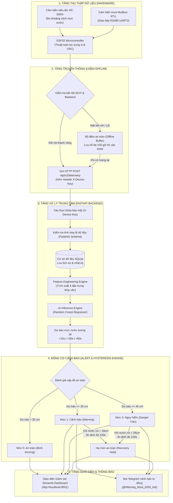

# HƯỚNG DẪN SỬ DỤNG VÀ LUỒNG VẬN HÀNH TOÀN DIỆN (SYSTEM FLOW)
## HỆ THỐNG GIÁM SÁT VÀ CẢNH BÁO SỚM NGẬP LỤT ĐÔ THỊ (MINI FLOOD AI-IOT)

---

## 1. TỔNG QUAN HỆ THỐNG

Dự án **Mini Flood AI-IoT** là hệ thống nhúng kết hợp Trí tuệ nhân tạo (AI) và Internet of Things (IoT) nhằm giám sát mực nước và lượng mưa theo thời gian thực trên mô hình thu nhỏ (scale-model). Hệ thống không chỉ đo lường hiện trạng tức thời mà còn **dự báo trước mực nước trong 15 giây, 30 giây và 1 phút tới** bằng mô hình học máy (Machine Learning - Random Forest), từ đó tự động đưa ra các mức cảnh báo và gửi thông báo khẩn cấp qua **Telegram** và **Dashboard trực quan**.

---

## 2. LUỒNG VẬN HÀNH CỦA HỆ THỐNG (SYSTEM FLOW)

Hệ thống hoạt động theo một luồng khép kín từ cảm biến thực tế đến người sử dụng cuối:



---

## 3. CHI TIẾT CÁC TẦNG TRONG LUỒNG HOẠT ĐỘNG

### 3.1. Tầng phần cứng và Cảm biến (Hardware Layer)
- **Cảm biến siêu âm HC-SR04 (GPIO18 Trig, GPIO19 Echo):**
  - Phát sóng siêu âm tần số 40 kHz, đo thời gian sóng phản xạ từ mặt nước.
  - Mỗi chu kỳ 5 giây, firmware bắn 3 xung siêu âm liên tiếp và lấy giá trị trung bình hợp lệ để loại trừ sóng phản xạ sai hoặc bọt nước.
  - Công thức tính: $\text{Mực nước} = \text{Độ cao lắp đặt (40 cm)} - \text{Khoảng cách đo được}$.
- **Cảm biến mưa Modbus RTU RS485 (GPIO16 RX2, GPIO17 TX2):**
  - Giao tiếp công nghiệp chuẩn Modbus RTU, tốc độ 4800 bps.
  - ESP32 gửi chuỗi byte truy vấn thanh ghi tổng lượng mưa `0x0000`, cảm biến trả về dữ liệu kèm 2 byte kiểm tra lỗi **CRC16**. Firmware kiểm tra CRC nghiêm ngặt trước khi nhận diện dữ liệu mưa hợp lệ.

### 3.2. Tầng truyền dữ liệu và Chống mất dữ liệu (IoT Communication)
- **Chu kỳ gửi tin:** Cố định **5 giây / lần**.
- **Cơ chế khám phá mDNS:** ESP32 tự động quét tìm dịch vụ `mini-flood-backend.local:8000` trên mạng nội bộ mà không cần cài cứng IP máy tính.
- **Bảo mật:** Mỗi gói tin HTTP POST bắt buộc kèm Header `X-Device-Key`.
- **Hàng đợi chống mất dữ liệu (Offline Ring Buffer):**
  - Nếu Wi-Fi mất hoặc máy tính tắt, ESP32 tự động lưu các gói tin vào mảng nhớ vòng (tối đa 100 bản ghi).
  - Ngay khi kết nối mạng được phục hồi, hàm `flushQueue()` sẽ tuần tự đẩy toàn bộ các gói tin cũ lên máy tính, đảm bảo dữ liệu lịch sử liên tục không bị đứt đoạn.

### 3.3. Tầng Trí tuệ nhân tạo (AI Inference Engine)
Mô hình AI sử dụng thuật toán **Random Forest Regressor (Rừng cây quyết định ngẫu nhiên)** được lưu trong [models/current/](file:///Users/hailey/STEM/models/current/):
1. **4 đặc trưng đầu vào (Features):**
   - `water_level_cm`: Mực nước đo được tức thời.
   - `water_delta_window_cm`: Tốc độ dâng của nước trong 10 giây gần nhất ($\Delta h$).
   - `rain_rate_mmh`: Cường độ mưa hiện tại.
   - `rain_sum_window_mm`: Tổng lượng mưa tích lũy trong 15 giây qua.
2. **3 mốc thời gian dự báo (Horizons):**
   - **+15 giây:** Độ chính xác $R^2 = 99.8\%$, sai số trung bình $MAE = 0.30\text{ cm}$ (~3 mm).
   - **+30 giây:** Độ chính xác $R^2 = 98.2\%$, sai số trung bình $MAE = 0.81\text{ cm}$ (~8 mm).
   - **+60 giây (1 phút):** Độ chính xác $R^2 = 90.2\%$, sai số trung bình $MAE = 1.84\text{ cm}$.

### 3.4. Tầng Động cơ Cảnh báo (Alert Engine & Hysteresis)
- **Ngưỡng quy chuẩn mô hình:**
  - Ngưỡng tràn (Nguy hiểm): $40.0\text{ cm}$
  - Ngưỡng cảnh báo: $30.0\text{ cm}$ (cách ngưỡng tràn $10\text{ cm}$)
  - Độ trễ nhả an toàn (Hysteresis): $2.0\text{ cm}$ (nước phải rút xuống dưới $30 - 2 = 28.0\text{ cm}$)
  - Thời gian giữ an toàn (Recovery Hold): **120 giây (2 phút)**
- **Nguyên lý chống báo động giả:** Nước rút xuống dưới $28\text{ cm}$ phải duy trì liên tục đủ 2 phút thì hệ thống mới chuyển trạng thái về "An toàn". Điều này ngăn ngừa còi và tin nhắn Telegram kêu liên tục khi sóng nước dập dờn quanh mép báo động.

---

## 4. HƯỚNG DẪN KHỞI ĐỘNG VÀ VẬN HÀNH HỆ THỐNG

### Bước 1: Khởi động Backend API (FastAPI)
Mở một cửa sổ Terminal trong VS Code và chạy lệnh:
```bash
source .venv/bin/activate
python -m uvicorn mini_flood_api:app --host 0.0.0.0 --port 8000
```
- Khi chạy thành công, Terminal sẽ báo: `Uvicorn running on http://0.0.0.0:8000`.

### Bước 2: Khởi động Giao diện Giám sát (Streamlit Dashboard)
Mở một cửa sổ Terminal thứ hai và chạy lệnh:
```bash
source .venv/bin/activate
streamlit run app_mini_flood_dashboard.py --server.port 8501
```
- Trình duyệt sẽ tự động mở trang Dashboard tại địa chỉ: [http://localhost:8501](http://localhost:8501).

### Bước 3: Cấp nguồn cho mạch ESP32
1. Cắm cáp Micro-USB / Type-C nối ESP32 với cổng USB máy tính (hoặc củ sạc 5V-2A).
2. Để xem log hoạt động trực tiếp của mạch:
   - Trên VS Code, mở biểu tượng **PlatformIO** (con kiến ở thanh bên trái).
   - Bấm vào mục **General** $\rightarrow$ chọn **Monitor** (hoặc biểu tượng hình cái phích cắm ở đáy thanh trạng thái).
   - Monitor sẽ hiện thông tin:
     ```text
     [SENSOR] profile=real_hardware seq=1 water=27.8cm rain=0.0mm/h queue=0
     [HEALTH] profile=real_hardware wifi=OK backend=OK water=OK rain=modbus_crc_ok
     [HTTP] POST seq=1 -> 200 OK
     ```

---

## 5. KỊCH BẢN THỰC HÀNH TEST DEMO (DÀNH CHO BÁO CÁO STEM / GIÁM KHẢO)

Bạn hãy thực hiện lần lượt 4 kịch bản mẫu sau đây trước mặt thầy cô / ban giám khảo:

### 🟢 Kịch bản 1: Giám sát Trạng thái Bình thường (Tĩnh)
- **Thao tác:** Đặt cảm biến cách đáy khay chứa khoảng 12 – 13 cm (mực nước đáy $\approx 27 - 28\text{ cm}$). Không đổ nước, không tạo mưa.
- **Hiện tượng quan sát:**
  - **Serial Monitor:** Gửi gói tin mỗi 5 giây với trạng thái `200 OK`.
  - **Dashboard:** Bảng dữ liệu cập nhật dòng mới mỗi 5 giây, cột trạng thái hiện màu xanh: `Bình thường`.
  - **Telegram:** Hoàn toàn im lặng (đúng thiết kế không spam tin nhắn).

### 🟡 Kịch bản 2: Nước dâng - Kích hoạt Cảnh báo Sớm (Early Warning)
- **Thao tác:** Đưa lòng bàn tay hoặc miếng bìa lại gần cảm biến siêu âm HC-SR04 (cách mắt cảm biến khoảng **8 – 9 cm**).
- **Hiện tượng quan sát:**
  - Khoảng cách đo ngắn lại $\rightarrow$ mực nước tính toán tăng lên $\approx 31 - 33\text{ cm}$ ($\ge 30\text{ cm}$).
  - Tốc độ dâng $\Delta h$ trong 10 giây tăng vọt.
  - **Dashboard:** Cột trạng thái lập tức chuyển sang màu vàng: `Cảnh báo`.
  - **Telegram:** Bot rung chuông gửi ngay tin nhắn:
    > `[GIÁM SÁT MỰC NƯỚC]`  
    > `🟡 CẢNH BÁO NGUY CƠ NGẬP`  
    > `Trạng thái: 🟡 Cảnh báo`  
    > `Dự báo 15 giây: 32.5 cm`  
    > `Nguyên nhân: Mực nước đang dâng nhanh`  
    > `🟡 Kết luận: Mực nước hoặc dự báo đang ở mức cảnh báo, cần chú ý theo dõi.`

### 🔴 Kịch bản 3: Đỉnh lũ - Kích hoạt Báo động Nguy hiểm (Tràn bờ)
- **Thao tác:** Đưa tay lại gần sát cảm biến hơn nữa (cách mắt cảm biến khoảng **4 – 5 cm**).
- **Hiện tượng quan sát:**
  - Mực nước vọt lên $\ge 40\text{ cm}$ (vượt ngưỡng tràn).
  - AI nhận diện nguy cơ tràn bờ sau 15 giây đến 1 phút tới ($> 40\text{ cm}$).
  - **Dashboard:** Nhấp nháy cảnh báo đỏ: `Nguy hiểm`.
  - **Telegram:** Bot gửi tin nhắn khẩn cấp:
    > `[GIÁM SÁT MỰC NƯỚC]`  
    > `🔴 CẢNH BÁO NGUY CƠ NGẬP (NGUY HIỂM)`  
    > `Trạng thái: 🔴 Nguy hiểm`  
    > `Dự báo 1 phút: 41.2 cm`  
    > `🔴 Kết luận: Nguy cơ ngập tràn rất cao! Cần kích hoạt phương án ứng phó khẩn cấp.`

### 🟢 Kịch bản 4: Nước rút - Quá trình Hạ mức An toàn (Recovery)
- **Thao tác:** Bỏ tay ra khỏi cảm biến để khoảng cách trở lại bình thường (mực nước rút về $27 - 28\text{ cm}$).
- **Hiện tượng quan sát:**
  - Mực nước rút sâu dưới $28\text{ cm}$ ($< 30 - 2\text{ cm}$).
  - Trong 2 phút đầu, hệ thống tiếp tục theo dõi để đảm bảo không bị sóng nước dập dờn.
  - Sau đủ thời gian ổn định (120 giây), hệ thống tự động hạ cấp và Telegram bắn tin:
    > `[GIÁM SÁT MỰC NƯỚC]`  
    > `🟢 TRẠNG THÁI ĐÃ HẠ MỨC`  
    > `Trạng thái: 🟡 Cảnh báo (hoặc 🟢 An toàn)`  
    > `🟢 Kết luận: Mực nước đã hạ về mức an toàn và duy trì ổn định.`  
    > `Thời gian đo: 23:51:00 02/11/2026 (GMT+7)`

### 📶 Kịch bản 5: Mất mạng & Khả năng Chống mất dữ liệu (Offline Buffer)
- **Thao tác:** Tắt Wi-Fi máy tính hoặc rút dây cáp mạng trong khoảng 30 giây (khoảng 6 chu kỳ gửi tin).
- **Hiện tượng quan sát:**
  - **Serial Monitor ESP32:** Báo `wifi=FAIL` hoặc `backend=FAIL`, nhưng hàng đợi tự động tăng lên: `queue=1`, `queue=2`, `queue=3`... (cảm biến vẫn đo và lưu vào RAM, không bị mất).
  - **Bật mạng lại:** ESP32 tự động kết nối lại, xả toàn bộ hàng đợi (`queue=0`). Toàn bộ 6 gói tin bị gián đoạn lập tức xuất hiện đầy đủ trên biểu đồ lịch sử Dashboard mà không có một khoảng trống dữ liệu nào!

---

## 6. CÁC BIẾN CẤU HÌNH TRONG FILE `.env`

File [.env](file:///Users/hailey/STEM/.env) đặt tại thư mục gốc giúp bạn dễ dàng tùy chỉnh hệ thống:

```env
# Môi trường chạy thực tế
MINI_FLOOD_MODE=demo
MINI_FLOOD_DEFAULT_DEVICE_ID=mini-flood-demo
MINI_FLOOD_DEVICE_KEY=mini-flood-secret-key-2026

# Kích hoạt luồng chạy ngầm gửi tin Telegram (1: Bật, 0: Tắt)
MINI_FLOOD_NOTIFICATION_WORKER=1

# Cấu hình Bot Telegram
MINI_FLOOD_TELEGRAM_TOKEN=9104094392:AAHhKTk3WyWwmYodgBKDUwZK15uUrjsZxBk
MINI_FLOOD_TELEGRAM_CHAT_ID=8139226834

# Thời gian giữ an toàn trước khi hạ mức (giây) - Mặc định 120s
# Khi demo có thể chỉnh thành 15 để thấy chữ "An toàn" nhanh hơn
MINI_FLOOD_DEFAULT_RECOVERY_HOLD_SECONDS=120
```

---

## 7. BẢNG TỔNG KẾT THÔNG SỐ ĐÁNH GIÁ CHẤT LƯỢNG KHOA HỌC (STEM METRICS)

| Tiêu chí | Thông số kỹ thuật của dự án | Ý nghĩa khoa học |
| :--- | :--- | :--- |
| **Thuật toán học máy** | Random Forest Regressor (200 cây quyết định) | Phù hợp với bài toán chuỗi thời gian phi tuyến tính trong thủy văn. |
| **Độ chính xác dự báo 15s** | $R^2 = 99.8\%$, $MAE = 0.30\text{ cm}$ | Sai số chỉ khoảng 3 mm, cực kỳ chính xác cho mô hình thu nhỏ. |
| **Độ chính xác dự báo 1 phút** | $R^2 = 90.2\%$, $MAE = 1.84\text{ cm}$ | Vượt trội gấp 3.6 lần so với phương pháp giữ nguyên giá trị truyền thống. |
| **Độ trễ truyền nhận (Latency)** | $< 250\text{ ms}$ trên mạng Wi-Fi nội bộ | Đạt chuẩn thời gian thực (Real-time IoT). |
| **Khả năng chịu lỗi (Resilience)** | Hàng đợi đệm vòng 100 bản ghi trên ESP32 | Chống rớt mạng lên tới hơn 8 phút liên tục mà không mất dữ liệu. |

